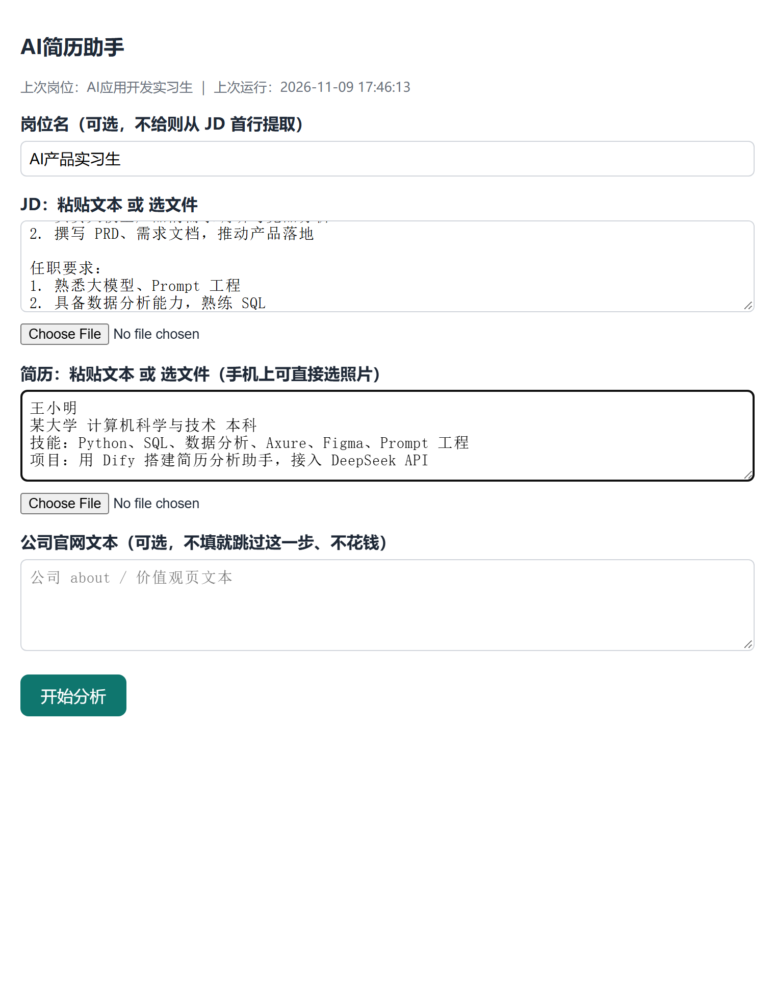

# AI 简历助手

把你的简历和一份岗位 JD 交给它，自动产出「值不值得投 + 为什么 + 差什么 + 怎么补 + 打招呼第一句」，人只负责最后决定投不投。

> 实测环境：Windows 11 + Python 3.12（最后验证 2026-11-09）



## 它解决什么

- **投不投靠感觉，同一份简历对同一岗位可能给出不同结论。** 本工具用「机械预筛 + 五维加权评分 + 按输入缓存」，把判断口径写成代码里的硬约束，同输入结果一致。
- **只改简历、不看 JD，改不到点上。** 它把 JD 拆成硬性要求与关键词，逐条对照简历，给出「差什么、怎么补」，还附关键词覆盖率。
- **改完简历还是讲不清项目。** 简历顾问会产出项目叙事块、逐条对齐 JD、改写对照、面试追问树和「一周能补的证据」。

**和直接跟 AI 聊天改简历的区别**：聊天式每次都要重新交代背景、结论随模型波动、也不知道到底花了多少 token；本工具把「原文出处校验、加权分数口径、预筛与预算闸门」做成代码约束，同输入同输出，并且明明白白告诉你每一步花了多少次调用、多少字。

## 能做什么

### 命令行（8 个子命令）

| 命令 | 用途 | 是否实测 |
|---|---|---|
| `run` | 单份简历 + 单个 JD 跑一遍（四步流水线 + 关键词覆盖率） | ✅ |
| `advisor` | 简历顾问：对标 JD 优化简历 + 项目叙事 + 面试引导 | ✅ |
| `batch` | 一份简历对多个 JD 批量跑，带机械预筛 + 预算闸门 | ✅ |
| `sources` | 按岗位类别 + 城市生成各平台搜索链接（不抓取、不登录、不投递） | ✅ |
| `collect` | 把「岗位 JD」目录里的 `.txt` 汇总成 `jobs.jsonl` | ✅ |
| `export` | 把结果导出 Excel / PDF | ✅ |
| `feishu` | 写入飞书多维表格 | ⚠️ 缺密钥未实测跑通 |
| `ledger` | 投递台账（待投 / 已投 / 已回复 / 已放弃） | ✅ |

### 网页里能做

打开网页版后，一个表单 + 结果卡片流：

1. **简历诊断**：填岗位名、JD、简历（可传 PDF/图片/粘贴文本），出结论、四维分、理由、差什么、怎么补、打招呼第一句、关键词覆盖率。
2. **简历顾问**：诊断后点一下，出「逐条对齐 JD + 项目叙事块 + 改写对照 + 一周证据 + 面试追问树」，只多花 1 次调用。
3. **导出**：Excel / PDF / 简历顾问 Markdown。

## 三种用法

### 1. 命令行（最稳）

```bash
python -m pipeline.cli run --resume 简历.pdf --jd 岗位.txt
```

### 2. 网页（本机浏览器）

```bash
python -m pipeline.webapp --port 8010
# 浏览器打开 http://127.0.0.1:8010
```

### 3. 手机（局域网）

手机和电脑连同一个 WiFi（或电脑开移动热点、手机连它），再：

```bash
python -m pipeline.webapp --host 0.0.0.0 --port 8000 --password 你的口令
# 手机浏览器打开 http://<电脑的内网IP>:8000，输入同样的口令
```

> 两个端口各司其职：**8010 = 网页版（只本机）**，**8000 = 手机版（局域网，必须设口令）**，别混。Windows 下可把上面命令存成 `.bat` 双击运行。

## 安装

> 下面所有命令都在**仓库根目录**下执行（`cd ai-resume-assistant` 之后）。在别的目录跑 `python -m pipeline...` 会报 `No module named 'pipeline'`。

```bash
# 1. 建虚拟环境（不要直接 pip 装进系统 Python）
python -m venv .venv
.venv\Scripts\activate        # Windows PowerShell / cmd
# macOS / Linux 用：python3 -m venv .venv && source .venv/bin/activate

# 2. 装依赖
pip install -r requirements.txt

# 3. 配置密钥
# Windows: copy .env.example .env     macOS/Linux: cp .env.example .env
# 编辑 .env，把 DEEPSEEK_API_KEY= 后面填成 sk- 开头的真实 key

# 4. 启动
python -m pipeline.webapp --port 8010
```

> `playwright` 的 chromium 浏览器只有在「导出 PDF」时才需要（官网采集函数也用，但目前没有对外命令）。只跑主流程 + 导出 Excel 可以跳过：
> `playwright install chromium`（会额外下载约 100 MB）。

## 模型与密钥

- **模型**：默认 `deepseek-chat`（DeepSeek 官方非思考模型别名）。可在 `.env` 里用 `DEEPSEEK_MODEL` 换成你控制台里对应的模型名。
- **密钥**：只在本地 `.env` 填 `DEEPSEEK_API_KEY`，绝不提交（本仓库是 public）。服务端日志和 `data/` 下都不会出现 key 明文。

## 要花多少钱

先说原则：最大成本不是 API，是「装不上、跑不动、等太久、存太多」。

| 成本 | 真实数字 | 说明 |
|---|---|---|
| API 调用 | 单岗 4 次调用（公司文本留空则 3 次）+ 顾问 1 次 | 实测 56 次调用 = 72,218 输入 tokens + 32,190 输出 tokens，按官方价折算约 0.14 元；单岗约 1 分钱量级，每天几岗用一个月 < 1 元 |
| 失败重跑 | 重跑 = 再花一次钱 | 第 3 步解析失败已改「占位降级」不再整岗作废；缓存命中后同输入不重复花钱 |
| 时间 | 图片简历首次 OCR 约 9 秒；单岗全流程 20–70 秒；命中缓存秒回 | 批量 10 岗约 1–3 分钟 |
| 依赖体积 | venv 约 400 MB（实测 415 MB） | 大头是 playwright 的 chromium；不装 chromium 可省约 100 MB |
| 磁盘 | 每次运行约 0.04 MB | 长期用建议定期清 `data/runs/` |
| 人工校对 | 图片简历 OCR 有字符级错字 | 图片简历建议人工过一遍；PDF 文本层简历基本无错 |
| 维护 | 岗位搜索链接会随平台改版失效 | 打不开就手动搜关键词 |
| 风险 | key 泄露 + 误判 | key 只存本地 `.env`、不提交、不进日志；分数是代码加权算的、不是模型自评，但结论仍需人判断 |

> 目前密钥是填在 `.env` 里的，所有通过这个服务发起的分析都用这一把 key。**如果要把服务给别人用，对方花的还是你的 key 钱**——「每人各自填 key」还没做（见 `PLAN.md` 的 T5/T6）。

## 你的数据去哪了

只写可验证的行为，不写态度。

1. **简历存在哪**：`data/runs/<时间戳>/00_resume.txt`（明文文本，本地硬盘）。
2. **会不会发给第三方**：会——简历/JD 的**文字**会发给 DeepSeek API 做分析。
3. **发的是原文件还是文字**：只发提取后的文字，不发原始 PDF/图片。
4. **有没有缓存**：有，`data/cache/` 按 sha256 存中间产物，同输入不重复调用。
5. **日志记什么**：`data/api_calls.jsonl` 只记时间/步骤/token 数，不记简历内容、不记 key。
6. **怎么彻底删**：删 `data/runs/<时间戳>` 和 `data/cache/` 即可（附路径见上）。
7. **别人能不能看到**：本机跑 = 只有你；用 `--host 0.0.0.0` 或隧道公网部署 = 能访问到服务的人都能看到，务必设口令。

## 限制与已知问题

1. 图片简历 OCR 有字符级错字（`AI`→`Al`、`迭代`→`选代`、`表达`→`表法`），PDF 文本层简历无此问题。
2. Excel 导出无列宽、无自动换行，长理由挤在一格；单份报告建议用 PDF。
3. `.docx` 简历**不支持**（只支持 PDF / 图片 / 粘贴文本）。
4. 岗位搜索只生成平台链接，**不自动抓取岗位列表**（抓取会因登录态/验证码/改版随时坏）。
5. 手机端只在局域网验证过，真机手指点过没做全。
6. PWA 是空壳（`sw.js` 42 字节），不能离线。
7. 飞书写入缺密钥与多维表格结构，从未真实跑通。
8. 岗位名不给时会从 JD 首行机械提取；首行含「岗位职责/任职要求」这类词或超 30 字时，回退为「未提供岗位名」占位（是回退，不是截断）——建议手动给岗位名。
9. 不自动投递、不自动打招呼（合规红线，永不实现）。
10. Linux / macOS 未验证，目前只在 Windows + Python 3.12 实测。

## FAQ / 排错

| 现象 | 原因 | 解决 |
|---|---|---|
| `错误：文件不存在：简历.pdf` | 照抄了文档里的占位符，自己机器上没有这个文件 | 换成你真实的文件路径，用引号包住 |
| `[Errno 10048]` / `Port 8010 is already in use` | 上一次的服务没关，端口被占 | `Get-NetTCPConnection -LocalPort 8010` 找到 PID，`Stop-Process` 停掉，或重启电脑 |
| `缺少环境变量 DEEPSEEK_API_KEY` | 没建 `.env` 或没填 | 复制 `.env.example` 为 `.env`，填你的 DeepSeek API key |
| `无法识别的 cmdlet` / `CommandNotFound` | 命令被拆断（参数之间缺空格） | 每个参数之间必须有空格；整条命令一次粘贴 |
| 结果里技能写成 `Al` | 图片 OCR 把 `AI` 认成 `Al` | 改传 PDF 或文字版简历，或在网页里手动改解析结果 |
| 分数每次不一样 | 同输入有缓存，连跑应一致；不一致可能缓存被改或换了文件 | 同一输入连跑 3 次应完全一致，不一致请提 issue |
| 飞书报权限错误 | 应用没加进多维表格协作者 | 把应用加为表格协作者，并填好飞书应用凭证与表格 ID |

## 许可

本项目采用 MIT 许可，详见 [LICENSE](LICENSE)。

## 开发说明

```
pipeline/   核心逻辑（纯函数，不含 UI）
  steps.py   四步流水线 + 关键词覆盖率
  advisor.py 简历顾问（复用前四步产物，只多 1 次调用）
  scoring.py 五维加权评分（确定性，非 LLM 自评）
  prefilter.py 机械预筛（零成本，不调模型）
  sources.py / collect.py 岗位搜索链接 / 岗位 txt 汇总
  webapp.py  本地 Web 服务（SQLite 存任务索引）
prompts/    各步 prompt（.md）
data/       运行产物（runs/ cache/ ledger.jsonl api_calls.jsonl），已被 .gitignore 忽略
```

加一个步骤：在 `prompts/` 加 `NN_xxx.md`，在 `steps.py`（或 `advisor.py`）加一个 `llm.chat_json(...)` 调用，走同一套计量与缓存即可。
